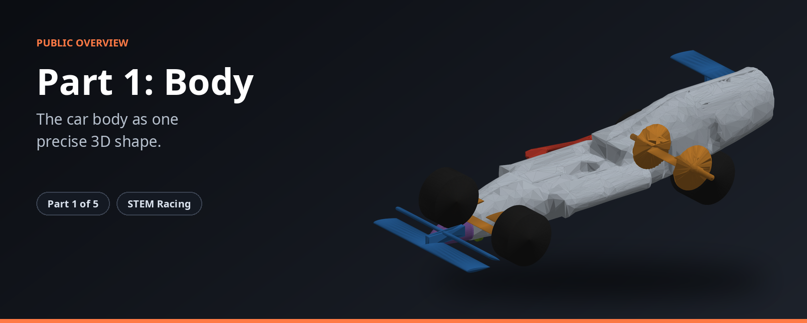
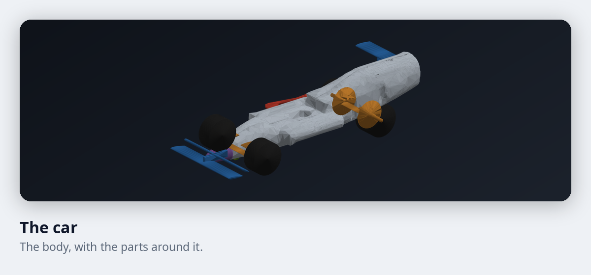
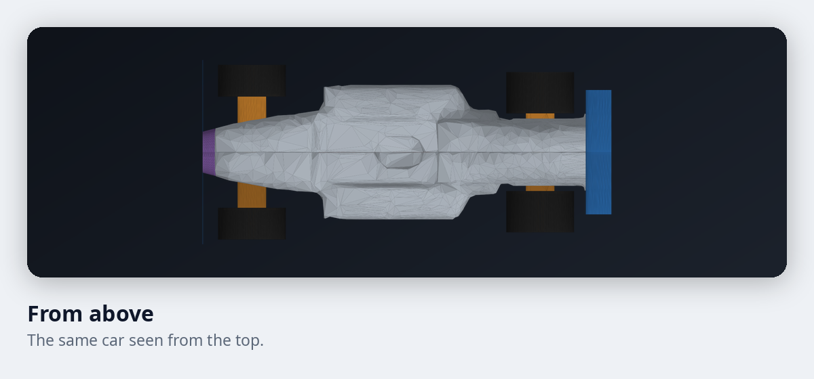

# STEM Racing, Part 1: Body

**The car body as one precise 3D shape.**

Part 1 builds the car body. It follows the competition rules from the first step, and it is shaped so a team can really cut it on a milling machine.

| | |
|---|---|
| **Where it fits** | Part 1 of 5 in the STEM Racing toolkit |
| **What you get** | A precise 3D body, ready for the other parts. |
| **Built for** | Student teams and their mentors |

## What it does

| Feature | What it gives you |
|---|---|
| Rules built in | The body cannot break the size and shape rules, so a design never starts out illegal. |
| Made to be made | The shape respects what a real milling tool can cut, so the body can actually be machined. |
| Sized to the target weight | The body is sized so the finished car reaches its target weight. |
| Works with the fixed parts | The parts the rules require, such as the wheels, the halo and the gas canister, are placed in the model. |

## A look at the car

<table>
<tr>
<td width="50%"></td>
<td width="50%"></td>
</tr>
</table>

These pictures are real output from the toolkit.

## How it fits

Part 1 hands the body to Parts 2 to 5. The full toolkit has five parts. See the [overview of the whole toolkit](https://github.com/Shashanksaraswat123939/stem-racing-overview).

| Part | Page |
|---|---|
| 1 | [Body](https://github.com/Shashanksaraswat123939/part1-overview) |
| 2 | [Airflow and race time](https://github.com/Shashanksaraswat123939/part2-overview) |
| 3 | [Connections](https://github.com/Shashanksaraswat123939/part3-overview) |
| 4 | [Components](https://github.com/Shashanksaraswat123939/part4-overview) |
| 5 | [Design advisor](https://github.com/Shashanksaraswat123939/part5-overview) |

## Status

| | |
|---|---|
| Project | Active |
| Source code | Private |
| This repository | Overview only, with no code |

## Credits

Made by [@Shashanksaraswat123939](https://github.com/Shashanksaraswat123939) and [@mxnviir](https://github.com/mxnviir).

## Rights

This page is a public overview of a private project. It contains no source code and does not describe how the project is built.

All rights reserved. You are welcome to read this page and share the link. You may not copy, reproduce or recreate the project from this material, and you may not use it to train, prompt or instruct automated systems to produce a copy. See the [LICENSE](LICENSE) file.
